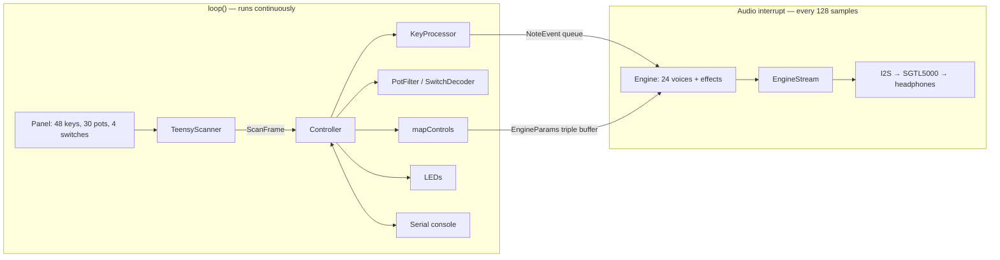

# L-wave firmware — reference

Firmware for the L-wave Tonnetz synth on a Teensy 4.1: 48 Hall-effect keys, 30 pots, 4 rotary switches, 9 LEDs, SGTL5000 headphone output. This document explains how the code is organised and how each part works. The second half is an API reference generated from the comments in the headers.

Version 0.1.0, written before the hardware exists: it compiles for the Teensy 4.1 and passes the host tests, but nothing has run on the real board yet.

## Contents

1. Building and running
2. Folder layout
3. How it fits together
4. Sound engine
5. Panel input
6. Boot modes, calibration and debug console
7. Storage
8. Teensy resources
9. Tests and renders
10. Browser simulator and hardware monitor
11. Known gaps and assumptions
12. API reference (generated)

## 1. Building and running

**Teensy firmware (on your PC).** Install VS Code and its PlatformIO extension, open the `firmware` folder, then use *Build* and *Upload* in the PlatformIO toolbar. The Teensy Loader opens by itself on the first upload. The serial console is *Monitor* in the same toolbar (115200 baud; any terminal works).

**Host build (tests and WAV renders).** Needs a C++17 compiler and CMake:

```
cmake -S firmware -B build
cmake --build build
build/lwave_tests              # runs all tests
build/lwave_render renders     # writes the demo WAV files into ./renders
build/lwave_render --bench     # CPU benchmark on this computer
```

**Browser simulator.** Open `simulator/lwave-sim.html` in Chrome or Edge, straight from the folder; no server is needed. To rebuild it after changing the firmware, run `firmware/tools/sim/build.sh simulator` (needs clang with the wasm32-wasi target and Node; see section 10).

**Regenerating the API reference.** After changing a header, run `python3 firmware/tools/gen_reference.py`. `--check` lists any public declaration without a doc comment.

## 2. Folder layout

| Path | Contents |
| --- | --- |
| `firmware/platformio.ini` | PlatformIO project for the Teensy 4.1 |
| `firmware/lib/lwave/src/lwave/` | Portable core: everything except the hardware access. Builds unchanged on the Teensy and a PC. |
| `firmware/lib/lwave/src/lwave/dsp/` | DSP building blocks: oscillators, filters, envelope, LFO, effects |
| `firmware/src/` | Teensy-only code: `main.cpp`, mux scanner, audio wrapper, platform services |
| `firmware/test/host/` | Host unit tests (own minimal framework, no dependencies) |
| `firmware/tools/render/` | WAV renderer and CPU benchmark |
| `firmware/tools/gen_reference.py` | Generates the API part of this document |
| `firmware/tools/sim/` | Browser simulator sources: `sim_api.cpp` (firmware ↔ browser glue), `sim_core.js`, `simulator.html`, build and test scripts |
| `simulator/lwave-sim.html` | The built simulator and hardware monitor: one self-contained file |
| `firmware/CMakeLists.txt` | Host build of tests and renderer |
| `docs/REFERENCE.md` | This document |

Everything is in namespace `lw`.

## 3. How it fits together

Two contexts run side by side and never wait for each other:

- **`loop()`** scans the panel continuously and runs the `Controller`.
- **The audio interrupt** (every 128 samples, 2.9 ms) runs `Engine::process()` through `EngineStream`.

They share data only through a lock-free `TripleBuffer<EngineParams>` (knob values, key depths) and an `SpscQueue<NoteEvent>` (note on/off, cue beeps).



One pass of `loop()`:

1. `TeensyScanner::scan()` steps the mux select lines through 16 channels, reads the five mux pins at each step (timestamping key readings), then reads the two direct switches, the battery and the line-out detect.
2. `Controller::onFrame()` converts raw readings with the calibration, runs the key state machines (note events go to the engine), smooths pots, debounces switches, maps everything to engine units and publishes it, updates LEDs and the battery monitor, and prints the debug stream if it is on.
3. Console input is read line by line and passed to `Controller::onLine()`.

## 4. Sound engine

`Engine` (engine.h) owns 24 `Voice`s (20 used by default, setting `voices`), one shared pink-noise generator, a global LFO, and the effects chain. One voice plays one key, including the detuned copies of each wave; reverb and delay tails use no voices.

**Per voice** (`Voice::render`), every sample:

1. Oscillators: saw and pulse with PolyBLEP anti-aliasing, triangle, table sine, then sub sines at −1 and −2 octaves. The four main waves are played in detuned copies, set by `detune_copies`:

   | `detune_copies` | Copies | Detune knob at 100 % (scaled by the knob curve: 1/3 of this at 70 %) |
   | --- | --- | --- |
   | 3 | centre + a low and a high copy, each at `detune_sides_db` (−6 dB) relative to the centre | low copy `detune_low_c` (23.17 c) below, high copy `detune_high_c` (37.5 c) above. 37.5 / 23.17 is the golden ratio, so the three beat rates (centre–low, centre–high, low–high) are golden-ratio multiples of each other and their peaks line up as rarely as possible |
   | 2 (default) | main + one higher copy at `detune_upper_db` (−6 dB) relative to the main | upper copy `detune_upper_c` (75 c) above |
   | 1 | main only | chorus amount (see the shared chain) |

   The copy amplitudes add up to 1, so all modes have the same level with the detune knob at 0. Detuned, the copies partly cancel on average, so mode 1 without chorus is about 3 dB louder than modes 2 and 3. The four waves share one phase per copy (they always run at the same pitch); a voice keeps five phases in all. With `osc_random_phase` 1 every note starts its oscillators at random phases, like free-running analog oscillators; with 0 (default) they all start together, so every note sounds the same. Oscillators whose slider is down are skipped. Copies above 0.45 × sample rate are muted to avoid aliasing.
2. Mix with the 7 level sliders, including the shared pink noise.
3. Filter (`VoiceFilter`), type from the filter switch: Comb (tuned feedback delay), Formant (3 band-passes at spoken-vowel formants, Peterson & Barney; the frequency knob sweeps A-E-I-O-U; key tracking does not move the vowels), Notch / BP / HP / LP12 (state-variable filter), LP24 (zero-delay-feedback ladder), Off.
4. Amplifier: ADSR × velocity gain × key depth × LFO volume modulation.

Every 16 samples (control rate) the voice updates its LFO, pitch, pulse width, detune, the depth ramp and the filter coefficients. Cutoff = knob × 2^(tracking × (note − 60)/12 + filter_env_oct × envelope knob × ADSR + LFO octaves).

**Envelope** (`Adsr`): the attack is an RC curve aimed at 1.3 and reaches 1 in the attack time. Decay and release are exponential and fall to −60 dB in their time. Releasing during the attack decays from the current level. With the Velocity knob above 66 % the decay waits at the peak until the key has arrived (it is 95 % down, or has not gone 2 % deeper for 50 ms) and the depth-driven level has caught up with the key.

**Velocity knob** (`velocityKnobWeights()`): it blends smoothly between four points. "Speed" is the strike speed (velocity, from the time between `key_vel_start` and `key_note_on`).

| Knob | Volume | Attack time |
| --- | --- | --- |
| 0 % | speed: the softest strike is `vel_range_db` (24 dB) quieter | the Attack knob |
| 33 % | speed, as at 0 % | Attack knob × `vel_attack_span`^±1: the softest strike 5 × longer, the hardest ⅕ |
| 66 % | not affected by speed | as at 33 % |
| 100 % | key depth: silent at the note-on point (`swell_note_on`, 10 %), full at the bottom, as (travel past that point)^`swell_curve` (2) | the note rises with the key, but no faster than 0 to full in the Attack knob's time (Attack 1 s: a hard strike takes 1 s, a 2 s press follows the key); the decay starts once the key has arrived and the level has caught up |

Between the points the weights move in straight lines: speed's say over the volume fades out from 33 to 66 %; from 66 to 100 % the envelope attack fades out and key depth takes over, its rise limited by the Attack knob. At 100 % a slow press is a crescendo, a quick strike an attack as fast as the Attack knob allows; the level falls with the key at once (no limit), so lifting the key slowly fades the note out before it ends, and a quick lift leaves the normal release. After release the level no longer rises. The serial `p` view names the nearest point, e.g. `66 % (speed->attack)`. In the simulator, the Slow press slider makes keys go down and back up over a set time to try this.

**Key depth** (`depth_mode`): 1 (default) multiplies the note level by the key's depth (from 66 % on the Velocity knob this blends into the depth mapping above). 2 scales only the sustain level. 0 ignores depth. A key's depth is the highest travel within the last `depth_freeze_ms` (20 ms). A key on its way up therefore doesn't dip the level before the note ends, and the value frozen at release matches the level just before it. The voice glides to depth changes over about 4 ms.

**LFO** (`Lfo`), shape from the waveform switch:

| Position | Shape | Behaviour |
| --- | --- | --- |
| 1 | Rise linear | Per note: rises by 1 per period. It reaches the set strength after one period and keeps rising while the note is held, until the destination hits its limit |
| 2 | Sink linear | Per note: falls by 1 per period, otherwise the same as Rise linear |
| 3 | Start high log | One-shot: starts at +1, decays exponentially to 0 (1 % after one period) |
| 4 | Start low log | One-shot: starts at −1, rises to 0 |
| 5–8 | Square, Saw, Triangle, Sine | Repeating, frequency = 1 / period |

The LFO delay knob fades repeating shapes in over the delay time. One-shot shapes hold their start value during the delay. Each voice has its own LFO, restarted at note-on. The Bitcrush and Delay destinations use one global LFO instead.

Limits for the open-ended Rise and Sink ramps: pitch ±48 semitones, volume gain 0 … 4 (+12 dB), detune 0 … 200 c, filter ±12 octaves (cutoff then clamps at 20 Hz and 0.45 × sample rate), PWM 0 … 100 %, delay time × 0.25 … 4.

**Switches act on new notes.** The filter type, LFO waveform and LFO destination are captured when a note starts, like the octave. Turning a switch changes the next note, not the ones already sounding. The global LFO (Bitcrush, Delay) takes its settings from the most recent note-on.

LFO depth at strength 100 %:

| Destination | Effect |
| --- | --- |
| Bitcrush | crush amount ±0.5 |
| Delay | delay time ±5 % (tape wobble) |
| Detune | copy offsets × (1 ± 1), up to 4 × the full-knob spread; no effect with `detune_copies` 1 |
| PWM | pulse width ±45 % |
| Filter freq | cutoff ±4 octaves |
| Volume & Pitch | both of the rows below; high volume coincides with low pitch |
| Pitch | ±12 semitones × strength² (fine vibrato is easy to dial) |
| Volume | gain 1 + strength × LFO, floored at 0 |

**Voice allocation**: one voice per key. Below the polyphony limit a free voice is used; at the limit the oldest release tail is stolen, then the oldest held note, with a 3 ms fade-out first. A second key playing a pitch that is already sounding starts in phase with it, so the two simply add. If the limit drops below the number of sounding notes (setting lowered, or the CPU guard below), the oldest release tails fade out over 3 ms first, then the oldest held notes.

**CPU guard** (`Controller::updateCpuGuard`): every 100 ms the controller reads the audio CPU load. Above `kCpuHighPercent` (90 %) it caps polyphony at two voices below what is sounding (never below `kMinVoiceCap`, 6); below `kCpuLowPercent` (70 %) it raises the cap by one voice every 0.5 s. The cap shows as `cap=` in the stats view, and the event log prints `EV voice_cap N` when it drops. It only acts on the Teensy; the simulator has no CPU figure.

**Shared chain** (`Engine::processBlock`): voice sum × `kVoiceSumTrim` → chorus (only with `detune_copies` 1) → overdrive → bitcrusher → delay → reverb → master volume → limiter → cue beeps → output. The trim is chosen so that one note with one slider at +12 dB and master at +12 dB peaks at about −1 dBFS.

| Effect | Implementation |
| --- | --- |
| Chorus | Juno style, mono: two taps of a 3.5 ms delay line swing in opposite directions on one triangle LFO (the Juno's left and right outputs summed), 9 kHz low-pass on the taps, equal-power mix with the dry signal. Detune knob: 0 = exact bypass; the mix reaches 50/50 at 40 %; the swing grows from ±0.6 to ±2 ms and the rate from 0.45 to 0.9 Hz. Level stays within about 1 dB of the dry signal |
| Overdrive | tanh soft clip, drive 30^amount, output ÷ √drive. Exact bypass at 0. |
| Bitcrusher | sample-and-hold down to 2 kHz (reached at 75 % of the knob), then quantisation from 16 to 3 bits (mostly in the last 60 %). Quantisation steps follow the signal's own peak level (200 ms release), so soft notes keep their tone at full crush |
| Delay | 16-bit buffer, read position glides like tape (~150 ms), 5 kHz low-pass in the feedback. Equal-power mix; knob 100 % = 50/50, the first echo as loud as the original |
| Reverb | Freeverb-style: 20 ms pre-delay, 8 damped combs tuned to the decay time, 4 all-passes. Equal-power mix; knob 100 % = 50/50, reverb as loud as the dry sound |
| Limiter | peak follower (0.5 ms attack, 120 ms release) to −1 dBFS, then a soft clip above 0.9 |

## 5. Panel input

**Keys** (`KeyProcessor`): travel 0..1 comes from `CalibrationData::keyTravel()` and works for either magnet polarity. The sensors are DRV5056 (unipolar): about 0.6 V (745 counts) with no field, rising as the magnet comes closer; on the first build a fully pressed key reads about 1.8 V. Until the keys are calibrated the firmware assumes 745 → 2150 counts. "Travel" here is really the field between the calibrated rest and bottom readings; on the first build it feels close to linear in the physical key travel (the magnet moves about 4 mm, from 7 to 3 mm from the sensor). Each key walks Idle → Timing → On → Idle:

| Setting | Default | Meaning |
| --- | --- | --- |
| `key_vel_start` | 10 % | Velocity timer starts (crossing time interpolated between samples) |
| `key_note_on` | 30 % | Note starts; velocity from the time since the start crossing |
| `key_note_off` | below 10 % | Note ends |
| `vel_fast_ms` / `vel_slow_ms` | 1 ms / 75 ms | Times mapped to velocity 1 and 0 on a log scale |
| `swell_note_on` | 10 % | Note starts with the Velocity knob at 100 % |

A key that turns back before 30 % plays nothing. With the Velocity knob above 66 % (`keySettingsFor()`) the note-on point moves from `key_note_on` towards `swell_note_on`, reaching it at 100 %; velocity timing starts no later than the note-on point, the note-off point stays at least 5 % below it (`kNoteOffGap`; 5 % at 100 %), and the velocity times shrink with the shorter timing distance so strike speeds still compare. The octave is read at note-on, so held notes keep their pitch when the octave switch moves.

**Pots** (`PotFilter`): calibrated position, one-pole smoothing (`pot_smooth_ms`), dead band (`pot_deadband`), and exact 0 and 1 at the ends. On the first PCB the 22 dials read high when turned fully counter-clockwise, so their position is inverted (`kPotReversed` in hw_map.cpp); the 8 sliders are not. Curves are applied by `mapControls()` and pass through the three values printed on the panel:

| Curve | Controls |
| --- | --- |
| Two log segments (`curveLog3`) | Reverb time (0.05–1–20 s); resonance (Q 0.05–1–20); filter frequency (20–640–20 000 Hz) |
| Fully logarithmic (`timeKnobCurve`, `curveLogFull`) | Attack, decay, release, LFO period, LFO delay and delay time: 10 ms at CCW, 0.32 s at centre, 10 s at CW (`kTimeKnobMinS`, `kTimeKnobMaxS`). Panel ticks 0.01, 0.02, 0.05, 0.1, 0.2, 0.5, 1, 2, 5, 10 s sit at 0, 10, 23, 33, 43, 57, 67, 77, 90, 100 % of the travel |
| Log to 0 (`LogTo0`) | Detune amount 0 … 1 (1/3 at 70 %), scaling the copy offsets: 2 copies +25 c at 70 %, +75 c at 100 %; 3 copies −7.7 / +12.5 c at 70 %, −23.17 / +37.5 c at 100 % |
| Linear | Sustain, velocity, LFO strength, mixes, delay feedback (0–90 %), filter envelope and tracking, overdrive, tune (±50 c), crush, PWM |
| Linear dB to 0 (`curveDbTo0`) | Master volume and the 7 level sliders: −24 dB … +12 dB (−6 dB at centre), fading to silence over the bottom 5 % |

Without PSRAM the delay buffer holds 2.5 s, and the delay-time knob ends there (10 ms … 2.5 s, still fully logarithmic).

**Switches** (`SwitchDecoder`): nearest calibrated voltage, accepted after `switch_debounce_ms` (20 ms) of stability.

**Battery** (`BatteryMonitor`): pin 15 × 3.3 V / 4095 × `batt_div`. For the first 0.5 s after power-up the voltage follows the reading directly, because the divider's filter capacitor is still charging; after that it is smoothed over ~2 s. LED 8 lights below `batt_low_v` (3.4 V) and blinks below `batt_crit_v` (3.2 V), with 0.05 V hysteresis, but never during the first second after power-up (`kBatteryWarnDelayS`). A battery that stays critical for 5 s switches the synth off (section 6, Power).

**LEDs**: 0–6 light at `meter_floor_db` + n × `meter_step_db` (−42 dBFS in 6 dB steps). LED 7 (red) lights at −1 dBFS or when the limiter is working. The meter follows peaks at once and falls at `meter_fall_db_s` (40 dB/s, one LED every 0.15 s). During calibration, LEDs 0–7 show progress.

## 6. Boot modes, calibration and debug console

| Hold at power-up | Mode |
| --- | --- |
| nothing | Normal. Without a complete calibration, a low warning tone plays and the serial port prints a hint. |
| C4 — key **D5** | Calibration |
| D3 — key **F4** | Debug: normal play plus the debug stream and event log |

Held keys are found by `detectHeldKeys()`. Calibrated keys use their travel; uncalibrated keys are compared with the median of all 48 readings, so this works before the first calibration.

**Calibration** (`Calibrator`):

1. A rising chime plays. Release the key and keep hands off; 0.5 s after all keys look released, rest values are measured for 2 s. A second chime plays.
2. Press every key fully. A key ticks at its own pitch once its span exceeds 400 counts and it has come back up.
3. Turn every dial and slider to both ends (within 400 counts of each rail); each ticks once.
4. Turn every rotary switch slowly through all 8 positions. A position counts once its reading stays within 40 counts for 60 ms and lies within 250 counts of its nominal ladder voltage ((8 − position) / 7 of full scale; readings between detents are ignored). Each new position ticks, higher positions at higher pitch; the position a switch rests on is counted straight away. When all 8 are found, a two-note chime plays.
5. When everything is done a chord plays, the result is saved, and the synth continues in normal mode. Hold C4 for 3 s to finish early: completed controls are saved, the rest keep their previous values.

The serial console follows along: it prints each phase, and every 5 s during the sweep what is still missing, for example `Calibration: 46/48 keys, 29/30 pots, 3/4 switches. Missing: keys A3 F7; pots flt_res (12-3410); switches octave missing 3 7`. Pots show the lowest and highest reading so far; each must reach within 400 counts of 0 and of 4095. While waiting for the keys to be released it names any key that still looks pressed. At the end it prints how many controls were calibrated and whether the save worked.

**Console commands** (USB serial, 115200 baud, line-based):

| Command | Effect |
| --- | --- |
| `help` | List commands |
| `info` | Firmware, hardware, PSRAM, sample rate, max delay, calibration status |
| `cal` | Start calibration without power-cycling |
| `debug [on\|off]` | Debug stream on/off (toggles without argument) |
| `r` `c` `k` `s` | Stream view: raw ADC, calibrated, active keys, stats |
| `p` | Lists every pot and switch once, then prints one line whenever one changes (0.5 % steps), with its value in real units |
| `m` | Machine-readable `MON` stream for the browser hardware monitor (section 10); also turns the event log on |
| `e` | Toggle the event log (note on/off with velocity, travel time and depth; switch changes; line-out plug) |
| `f` | Toggle table / CSV format (CSV is easy to plot) |
| `get [name]` | Show one or all settings |
| `set <name> <value>` | Change a setting live |
| `save` | Store settings and calibration |
| `defaults` | Reset settings to defaults (calibration kept, not saved) |
| `tone [hz]` | 1 s test tone |
| `leds` | Light each LED in turn |
| `reboot` | Restart |

The stats view shows mode, scan rate, audio CPU load (peak of the last 100 ms), sounding voices, the CPU guard's voice cap, output level, limiter reduction, battery voltage and line-out state. All settings are listed in the generated table in section 11.

**Power** (`PowerManager`, power.h). For the next hardware revision; on the first build pins 32 and 33 are unconnected, so it has no effect there.

| Pin | Use |
| --- | --- |
| 32 | Power button input, high = pressed. The internal pull-down keeps it released while nothing is connected. |
| 33 | Power hold output: low at start-up, high 2 s after start-up (`kPowerLatchS`) so the power stays on once the button is released; low again to switch off. |

The synth switches itself off when:

- the power button is held for 2 s (`kPowerButtonHoldS`). The press that switched it on does not count: the button must have been released once since start-up;
- it has not been used for `auto_off_min` minutes (default 60; `set auto_off_min 0` turns this off). Use means a note played, a pot moved by more than 3 % of its travel (`kActivityPotStep`), a rotary switch turned, a power-button press, or a line typed on the serial console. There is no auto-off during calibration;
- the battery has been critically low (below `batt_crit_v`) for 5 s (`kPowerBatteryOffS`). This happens once per low-battery episode.

Switching off releases all notes, plays three falling notes, turns all LEDs off, prints the reason on the serial console, and drops pin 33 after 0.6 s (`kPowerOffDelayS`, the length of the sound). After a long press the power goes when the button is released. If the synth is still running after that (powered over USB, or no power circuit fitted), a note, a pot or switch move, a console line or a new button press switches it on again and pin 33 goes high. `info` shows the power state and how long the synth has been unused; the stats view shows `pwr_btn` (button level) and `idle` (minutes unused).

## 7. Storage

`PersistentBlob` (storage_format.h) holds the calibration and settings, with a magic number, layout version and CRC-32. About 1 KB is written byte by byte to the Teensy's emulated EEPROM (4284 bytes) and read back to verify. Settings are stored as (hash of the console name, value) pairs, so a firmware that adds or removes settings keeps the others: unknown entries are ignored and missing ones keep their defaults. Blobs from versions 1–4, which stored the settings as a raw struct, still give their calibration; their settings reset to defaults and the console says so (`save` stores them in the new format). If the magic or CRC doesn't match, defaults are used. Bump `kBlobVersion` only if the blob layout itself changes; `CalibrationData` must stay at offset 8.

## 8. Teensy resources

| Pins | Use |
| --- | --- |
| 14, 16, 17, 22, 41 | Mux outputs U101 … U105 |
| 37, 36, 35, 34 | Mux select S0 … S3 |
| 25, 26 | LFO destination and octave switches (direct) |
| 15 | Battery sense |
| 9 | Line-out detect (reported only) |
| 10, 11, 12, 24, 27, 28, 29, 30, 31 | LEDs 0 … 8 (pin → LED → GND, high = on) |
| 7, 8, 18, 19, 20, 21, 23 | SGTL5000: I2S data, I2C, clocks (as on the Audio Shield) |
| 13 | On-board LED: alive blink at 1 Hz |
| 32 | Power button (input, pull-down; next hardware revision) |
| 33 | Power hold output (next hardware revision) |

Memory from the compile check (no PSRAM): flash 130 KB; RAM1 320 of 512 KB (94 KB code in a 96 KB block, 224 KB data); RAM2 231 of 512 KB (the 2.5 s delay fallback). With PSRAM fitted, `setup()` allocates a 20.5 s delay line there with `extmem_malloc()`, and the delay-time knob uses its full 10 s range.

CPU estimate from executed ARM instructions (the engine compiled for Thumb-2 with hardware float, counted under QEMU). One 128-sample block lasts 2.9 ms, which is about 1.74 million cycles at 600 MHz.

| Case | Instructions per block | Load at 1 cycle/instruction | at 1.5 cycles/instruction |
| --- | --- | --- | --- |
| Effects only (reverb, delay, limiter) | 67 k | 4 % | 6 % |
| Chorus (`detune_copies` 1) | 8 k | 0.5 % | 0.7 % |
| Per voice, typical (saw + square + sub 1, LP12, pitch LFO): 3 / 2 / 1 copies | 41 k / 35 k / 28 k | 2.4 / 2.0 / 1.6 % | 3.5 / 3.0 / 2.4 % |
| Per voice, heavy (all 7 sources, formant, overdrive, crush): 3 / 2 / 1 copies | 69 k / 60 k / 50 k | 4.0 / 3.4 / 2.9 % | 6.0 / 5.1 / 4.3 % |
| 20 voices, typical: 3 / 2 / 1 copies | 889 k / 758 k / 625 k | 51 / 44 / 36 % | 77 / 65 / 54 % |
| 20 voices, heavy: 3 / 2 / 1 copies | 1 451 k / 1 263 k / 1 074 k | 83 / 73 / 62 % | 125 / 109 / 93 % |

The Cortex-M7 runs this kind of float code at roughly 1 to 1.5 cycles per instruction, so typical patches fit 20 voices comfortably and extreme patches may not; the CPU guard (section 4) catches that. The real figure appears as `cpu=` in the debug stream.

## 9. Tests and renders

`lwave_tests` covers knob curves and mapping, settings, storage, the lock-free handoff, the hardware tables, key processing (velocity, half presses, depth freeze, reversed polarity), pots, switches, battery, boot detection, the full calibration routine, the engine (gain staging, envelope timing, every filter × LFO shape combination finite and bounded, voice stealing, fade-out order when the voice limit drops, phase-aligned duplicate pitches, PWM extremes, velocity level, LFO pitch settling), and the controller end to end with a fake platform (boot modes, playing a key, console, debug stream, battery LED, `MON` line format, CPU guard, power hold and auto-off). `test_power.cpp` covers the soft-power state machine (latch, long press, button bounce, hour-long idle, low battery); storage tests cover settings stored by name and reading the calibration from older blobs. `firmware/tools/sim/test_sim.js` checks the WebAssembly build of the same code.

`lwave_render` writes six demo scenes: Tonnetz triads, the eight filter types, the eight LFO shapes on pitch, the effects, velocity, and a pad.

## 10. Browser simulator and hardware monitor

`simulator/lwave-sim.html` is one self-contained page with two tabs.

**Simulator.** The page runs the real firmware in the browser: `Controller` and `Engine`, compiled unchanged to WebAssembly together with `firmware/tools/sim/sim_api.cpp`.

- **Simulated scanning:** every 128 samples the glue builds about six `ScanFrame`s (~2 kHz, as on the Teensy). It uses an ideal calibration: keys rest at 1000 counts and bottom at 3000, pots run 0–4095, switches sit at their nominal ladder voltages.
- **Key presses:** a press is animated as real key travel whose speed matches the chosen strike. Velocity timing, key depth, the release freeze, voice stealing, LEDs and the console therefore all behave as on the hardware.
- **Audio:** sound runs in an AudioWorklet, or on the main thread when the browser refuses worklets.
- **Ways to play:** mouse or touch on the hex keys; computer keys for rows B–E (`2`–`9`, `Q`–`O`, `A`–`K`, `Z`–`M`, by physical position); or a MIDI keyboard.
- **Console:** the serial console accepts every command from section 6.
- **Simulated inputs:** a battery-voltage slider and a line-out checkbox exercise LED 8 and the line-out report.

**Hardware monitor.** Uses Web Serial (Chrome or Edge, with the page opened from disk; the copy hosted on claude.ai cannot reach USB).

1. *Connect synth* opens the Teensy's USB serial port.
2. The page sends `info` (to learn the delay range for the labels) and then `m`.
3. It draws the panel exactly as the firmware sees it: calibrated and smoothed knob positions with their engine values, switch positions, key travel and note-on state, and LEDs.
4. Clicking a control shows its wiring, its raw ADC value and its position. The console stays live, so `set` and `get` work while you watch.

If a control looks wrong in the monitor, the fault is in reading the panel (wiring, calibration, thresholds). If it looks right but sounds wrong, the fault is in the sound engine or audio path. *Use the simulator as the source* sends the simulator's own `MON` stream through the same parser, to try the monitor without hardware.

**`MON` line format.** One line per debug update (`debug_rate_hz`, 50 Hz by default). Fields are space-separated `name=value`; all hex fields are fixed width and lower case:

| Field | Width | Contents |
| --- | --- | --- |
| `t` | – | Time in ms |
| `mode` | 1 | `n` normal, `d` debug, `c` calibration |
| `k` | 48 × 2 hex | Calibrated key travel, 0–255 |
| `n` | 48 chars | `1` where a note is on |
| `p` | 30 × 3 hex | Pot position after calibration and smoothing, 0–4095 (`Pot` order) |
| `s` | 4 digits | Switch positions 1–8 (`Switch` order) |
| `rk` | 48 × 3 hex | Raw key ADC values |
| `rp` | 30 × 3 hex | Raw pot ADC values |
| `rs` | 4 × 3 hex | Raw switch ADC values |
| `rb` | 3 hex | Raw battery ADC value |
| `led` | 9 chars | LED states 0–8 |
| `v`, `lvl`, `lim`, `cpu`, `bat`, `lo`, `scan` | – | Sounding voices, output dBFS, limiter dB, audio CPU %, battery V, line-out, scan rate Hz |

Event-log lines (`EV on …`, `EV switch …`, `EV line_out …`) arrive between `MON` lines and appear in the console.

**Rebuilding.** `firmware/tools/sim/build.sh [out-dir]` does three things:

1. Compiles the core with `clang++ --target=wasm32-wasi` (Ubuntu packages: `clang lld-18 wasi-libc libc++-18-dev-wasm32 libc++abi-18-dev-wasm32 libclang-rt-18-dev-wasm32`).
2. Runs `test_sim.js` in Node. It boots the WebAssembly firmware, plays a key, and checks sound, velocity, console and `MON` output.
3. Inlines everything into `lwave-sim.html`. The script also writes `lwave-sim.fragment.html`, the same page without the document skeleton, for hosting on claude.ai.

## 11. Known gaps and assumptions

- **Battery divider**: `batt_div` defaults to 2.0 (equal resistors). Set the real ratio with `set batt_div …` and `save`.
- **Line-out detect** only reports its level; its polarity and any pull-up are not yet known.
- **Scan rate and ADC settling** (`kSettleNs` = 1.5 µs) are untested on hardware; check `scan=` in the stats view (target ≥ 2 kHz).
- **Key thresholds and velocity times** are first guesses; tune them live with `set`.
- **Key response vs physical travel**: after calibration the keys on the first build feel close to linear. If a later build feels like the keys only start near the bottom, lower `key_vel_start` / `key_note_on` or add a linearising curve.
- **Triangle** is not band-limited. Its aliasing is low, but it may be audible on very high notes.
- **Overdrive** runs without oversampling; heavy drive on high notes can alias.
- **Compile check**: PlatformIO couldn't run in the build environment, so the Teensy build was checked with PJRC's current core sources and GCC 13 instead of PlatformIO's toolchain. Your first PlatformIO build is the real confirmation.

<!-- API REFERENCE: generated by firmware/tools/gen_reference.py, do not edit below -->

## API reference

Generated from the `///` comments in the headers. Every class, function and field is listed in the order it appears in its header.

### Settings (from settings.cpp)

| Setting | Default | Range | Meaning |
| --- | --- | --- | --- |
| `key_vel_start` | 0.10 | 0.01 … 0.9 | travel where velocity timing starts |
| `key_note_on` | 0.30 | 0.05 … 0.95 | travel where the note starts |
| `key_note_off` | 0.10 | 0.01 … 0.9 | travel below which the note releases |
| `vel_fast_ms` | 1.0 | 0.1 … 50.0 | travel time of the hardest strike (ms) |
| `vel_slow_ms` | 75.0 | 1.0 … 500.0 | travel time of the softest strike (ms) |
| `vel_range_db` | 24.0 | 0.0 … 60.0 | softest strike is this much quieter (dB) |
| `vel_attack_span` | 5.0 | 1.0 … 16.0 | attack factor from strike speed (Velocity knob 33-66 %) |
| `swell_curve` | 2.0 | 0.25 … 4.0 | Velocity knob 100 %: level = key travel ^ this |
| `swell_note_on` | 0.10 | 0.03 … 0.95 | Velocity knob 100 %: travel where the note starts |
| `depth_mode` | 1.0 | 0.0 … 2.0 | key depth: 0 off, 1 level, 2 sustain only |
| `depth_freeze_ms` | 20.0 | 0.0 … 60.0 | key depth = highest travel in this window (ms) |
| `voices` | 20.0 | 1.0 … kMaxVoices | polyphony in use |
| `pot_smooth_ms` | 10.0 | 0.0 … 200.0 | pot smoothing time (ms) |
| `pot_deadband` | 0.002 | 0.0 … 0.05 | pot dead band (0-1) |
| `switch_debounce_ms` | 20.0 | 1.0 … 200.0 | switch debounce time (ms) |
| `batt_div` | 2.0 | 1.0 … 10.0 | battery voltage divider ratio |
| `batt_low_v` | 3.4 | 2.5 … 4.2 | LED 8 on below this voltage |
| `batt_crit_v` | 3.2 | 2.5 … 4.2 | LED 8 blinks below this voltage |
| `meter_floor_db` | -42.0 | -90.0 … -6.0 | level that lights meter LED 0 (dBFS) |
| `meter_step_db` | 6.0 | 1.0 … 12.0 | dB between meter LEDs |
| `meter_fall_db_s` | 40.0 | 5.0 … 300.0 | meter fall speed (dB per second) |
| `filter_env_oct` | 6.0 | 0.0 … 10.0 | octaves the filter envelope opens |
| `detune_copies` | 2.0 | 1.0 … 3.0 | 3 centre+sides, 2 main+upper, 1 chorus |
| `detune_sides_db` | -6.0 | -30.0 … 0.0 | 3 copies: side level vs centre (dB) |
| `detune_upper_db` | -6.0 | -30.0 … 0.0 | 2 copies: upper level vs main (dB) |
| `detune_low_c` | 23.17 | 0.0 … 300.0 | 3 copies: low copy at full knob (cents below) |
| `detune_high_c` | 37.5 | 0.0 … 300.0 | 3 copies: high copy at full knob (cents above) |
| `detune_upper_c` | 75.0 | 0.0 … 300.0 | 2 copies: upper copy at full knob (cents above) |
| `osc_random_phase` | 0.0 | 0.0 … 1.0 | 1 = random oscillator start phase per note |
| `hp_volume` | 0.6 | 0.0 … 1.0 | codec headphone volume (0-1) |
| `auto_off_min` | 60.0 | 0.0 … 1440.0 | switch off after this many minutes unused (0 = never) |
| `debug_rate_hz` | 50.0 | 1.0 … 200.0 | debug stream rate (Hz) |

### Portable core (lib/lwave/src/lwave)

#### `calibration_data.h`

Stored calibration: per-key rest/bottom, per-pot ends, per-switch position voltages, and the conversions that use them.

- **struct `CalibrationData`** — Calibration values in raw 12-bit ADC counts. Plain data (stored as bytes).
    - `uint16_t keyRest[kNumKeys]` — Reading with the key up.
    - `uint16_t keyBottom[kNumKeys]` — Reading with the key fully down (may be below rest).
    - `uint16_t potMin[kNumPots]` — Lowest reading (CW end for the dials, bottom for the sliders).
    - `uint16_t potMax[kNumPots]` — Highest reading (CCW end for the dials, top for the sliders).
    - `uint16_t switchLevel[kNumSwitches][kSwitchPositions]` — Reading at positions 1..8.
    - `uint8_t keyValid[kNumKeys]` — 1 if the key was calibrated.
    - `uint8_t potValid[kNumPots]` — 1 if the pot was calibrated.
    - `uint8_t switchValid[kNumSwitches]` — 1 if the switch was calibrated.
    - `uint8_t pad[2]` — Keeps the size a multiple of 4.
    - `void setDefaults()` — Nominal values used until a calibration is stored: pots rail to rail, switch ladder at (8 - position) / 7 of 3.3 V, keys at 1050 counts at rest and 2100 fully down (measured on the first build: about 950-1045 up, 1950-2230 down).
    - `float keyTravel(int key, uint16_t raw) const` — Key travel 0 (rest) .. 1 (bottom), clamped. Works for either sensor polarity.
    - `float potPosition(int pot, uint16_t raw) const` — Pot position 0..1, clamped; inverted for pots marked in kPotReversed.
    - `int switchPosition(int sw, uint16_t raw) const` — Switch position 0..7 nearest to raw.
    - `bool complete() const` — True if every key, pot and switch has been calibrated.
    - `void counts(int& keys, int& pots, int& switches) const` — Number of calibrated keys, pots and switches.

#### `calibrator.h`

The guided calibration routine (hold C4 at power-up).

- **struct `Cue`** — An audio cue requested by the calibrator (played by the engine's beeper).
    - `float hz` — Frequency.
    - `float seconds` — Length.
    - `float delayS` — Start this long after the request (for chimes and chords).
- **class `Calibrator`** — Walks through calibration: 1. WaitRelease: waits until all keys look released (including the one held at boot). 2. Rest (2 s): records each key's rest value and noise. 3. Sweep: records each key's extreme, each pot's ends and each switch's 8 voltages. Keys and pots tick once when complete; a switch ticks for every new position (higher pitch for higher positions) and chimes when all 8 are found. A switch position counts once its reading stays within kSwitchJitter counts for kSwitchStableUs and lies within kSwitchNominalTolerance of the nominal ladder voltage (8 - position) / 7 of full scale, so readings between detents are ignored. 4. Done: when everything is complete, or after C4 is held for 3 s.
- **enum class `Phase`** — Calibration phase.
    - `void start(const CalibrationData& previous, uint32_t tUs)` — Starts a new calibration. `previous` supplies values for controls that end up not calibrated.
    - `void update(const ScanFrame& f)` — Feeds one scan frame.
    - `Phase phase() const` — Current phase.
    - `int drainCues(Cue* out, int max)` — Copies out pending audio cues (up to max); returns how many.
    - `const CalibrationData& result() const` — The result: previous values overwritten by every completed control.
    - `int keysDone() const` — Number of keys completed.
    - `int potsDone() const` — Number of pots completed.
    - `int switchesDone() const` — Number of switches completed.
    - `float progress() const` — Fraction 0..1 of all controls completed.
    - `bool keyDone(int k) const` — True if key k is complete.
    - `bool potDone(int p) const` — True if pot p is complete.
    - `bool switchDone(int s) const` — True if switch s is complete.
    - `int switchLevelsSeen(int s) const` — Number of distinct positions seen so far on switch s.
    - `bool switchPositionSeen(int s, int i) const` — True once position i (0 = position 1) of switch s has been recorded.
    - `void describeMissing(char* buf, int size) const` — Writes what is still missing during the sweep, for the serial console, e.g. "keys A3 F7; pots flt_res (12-3410); switches octave missing 3 7". Pots show the lowest and highest reading so far; each must come within kPotRailMargin of 0 and of full scale.
    - `void describeHeld(char* buf, int size) const` — Writes the keys that currently look pressed (while waiting for release).
    - `static constexpr int kMinKeySpan = 400` — Minimum key span (counts) between rest and bottom to accept a key.
    - `static constexpr int kPotRailMargin = 400` — A pot must come this close (counts) to each rail to be accepted.
    - `static constexpr int kSwitchJitter = 40` — A switch reading must stay within this many counts ...
    - `static constexpr uint32_t kSwitchStableUs = 60000` — ... for this long (µs) to count as a position.
    - `static constexpr int kSwitchNominalTolerance = 250` — A position's reading must be this close (counts) to its nominal ladder voltage.

#### `config.h`

Compile-time configuration. Everything here is fixed at build time. Values you may want to tune while playing live in Settings (settings.h) instead, so they can be changed from the serial console without recompiling.

- `constexpr float kDefaultSampleRate = 44100.0f` — Nominal audio sample rate in Hz. The Teensy runs at 44117.647 Hz; the engine is told the exact rate at start-up, this value is only a default.
- `constexpr int kBlockSize = 128` — Samples per audio block (matches the Teensy Audio library's AUDIO_BLOCK_SAMPLES).
- `constexpr int kSubBlock = 16` — Samples per control-rate step inside the engine. Envelopes, LFOs and filter coefficients are updated once per sub-block; oscillators run every sample.
- `constexpr int kMaxVoices = 24` — Voices allocated in memory. The number actually used is the `voices` setting (default 20), which can be set anywhere up to this value.
- `constexpr float kTimeKnobMinS = 0.01f` — Time-knob range (fully logarithmic between the two): attack, decay, release, LFO period, LFO delay and delay time.
- `constexpr float kTimeKnobMaxS = 10.0f` — Upper end of the time knobs (the delay time stops earlier without PSRAM).
- `constexpr float kCpuHighPercent = 90.0f` — CPU guard: above this audio CPU load the polyphony cap drops by two voices below what is sounding (never below kMinVoiceCap) …
- `constexpr float kCpuLowPercent = 70.0f` — … and below this load it rises again by one voice every 0.5 s.
- `constexpr int kMinVoiceCap = 6` — The CPU guard never caps polyphony below this.
- `constexpr float kBatteryFastS = 0.5f` — Battery: for this long after power-up the reading is followed directly (the divider's filter capacitor is still charging), then smoothed over ~2 s.
- `constexpr float kBatteryWarnDelayS = 1.0f` — Battery: no low or critical warning for this long after power-up.
- `constexpr float kPowerLatchS = 2.0f` — Power: the hold output (pin 33) goes high this long after start-up, so the power stays on once the power button is released.
- `constexpr float kPowerButtonHoldS = 2.0f` — Power: holding the power button this long switches off.
- `constexpr float kPowerButtonDebounceS = 0.02f` — Power: the button must be steady this long to count as pressed or released.
- `constexpr float kPowerBatteryOffS = 5.0f` — Power: the battery must stay critically low this long before switching off.
- `constexpr float kPowerOffDelayS = 0.6f` — Power: after deciding to switch off, the hold output drops this much later (time for the switch-off sound).
- `constexpr float kActivityPotStep = 0.03f` — Power: a pot must move this far (fraction of its travel) to count as use.
- `constexpr int kNumKeys = 48` — Number of note keys on the panel.
- `constexpr int kNumPots = 30` — Number of potentiometers: 22 dials + 8 sliders.
- `constexpr int kNumSwitches = 4` — Number of 8-position rotary switches.
- `constexpr int kSwitchPositions = 8` — Positions per rotary switch.
- `constexpr int kNumLeds = 9` — Number of LEDs: 0-7 volume meter, 8 battery warning.
- `constexpr uint16_t kAdcMax = 4095` — Full-scale value of the 12-bit ADC.
- `constexpr int kCombBufferSize = 1024` — Comb filter buffer per voice (samples). Sets the lowest comb pitch: sampleRate / kCombBufferSize, about 43 Hz at 44.1 kHz.
- `constexpr float kVoiceSumTrim = 0.0562f` — Internal level trim applied to the voice sum. Chosen so one note with one level slider at maximum (+12 dB) and master volume at maximum (+12 dB) peaks just below full scale (about -1 dBFS), as specified.
- `constexpr const char* kFirmwareVersion = "0.1.0"` — Firmware version string printed by `info`.

#### `control_mapper.h`

Panel positions → engine parameters, using the curves printed on the panel.

- **struct `PanelState`** — Panel state after calibration and filtering.
    - `float pot[kNumPots] =` — Positions 0..1, indexed by Pot.
    - `int sw[kNumSwitches] =` — Positions 0..7 (panel 1..8), indexed by Switch.
- `void mapControls(const PanelState& panel, const Settings& s, float maxDelayS, EngineParams& out)` — Fills every panel-derived field of `out` (all fields except keyDepth). maxDelayS is the longest delay the delay buffer allows; the delay-time knob is scaled so its full travel stays usable.
- `int octaveShiftSemitones(int octavePos)` — Semitone shift for an octave-switch position 0..7 (panel 1..8): position 4 → 0.
- `float timeKnobCurve(float p)` — Time-knob curve shared by attack, decay, release, LFO period and LFO delay: fully logarithmic, kTimeKnobMinS (10 ms) at CCW, 0.32 s at centre, kTimeKnobMaxS (10 s) at CW.
- `float curveLogFull(float p, float lo, float hi)` — Fully logarithmic curve from lo (p = 0) to hi (p = 1).
- `float detuneCurve(float p)` — Detune knob curve, 0..1: 0 at CCW, 1/3 at 70 %, 1 at CW (log to 0). It scales the copy offsets set by detune_low_c, detune_high_c and detune_upper_c.
- `float potEngineValue(const EngineParams& e, Pot pot)` — The engine-unit value pot `pot` drives in `e`: seconds, Hz, cents, Q, 0..1, or dB for the level sliders and master volume. Detune gives the cents of the highest copy (2 or 3 copies), or the chorus amount 0..1 with 1 copy.
- `void formatPotValue(const EngineParams& e, Pot pot, char* buf, int size)` — Writes that value with its unit (e.g. "164 ms", "2.91 kHz", "-6.0 dB") into buf.

#### `controller.h`

The controller: everything between the scanner and the sound engine. Boot modes, calibration, key and knob processing, LEDs, battery and the serial console. Portable; the platform supplies time, LEDs, storage and text output.

- **enum class `Mode`** — Operating mode.
- **enum class `DebugView`** — What the debug stream shows.
- **class `Controller`** — The controller. Call begin() once, boot() with the first scan, then onFrame() for every scan and onLine() for every console line.
    - `void begin(Platform& platform, Engine& engine)` — Loads calibration and settings from storage (defaults if none).
    - `void boot(const ScanFrame& first)` — Chooses the mode from the keys held in the first scan: C4 (key D5) → calibration, D3 (key F4) → debug, otherwise normal.
    - `void onFrame(const ScanFrame& f)` — Processes one complete scan.
    - `void onLine(const char* line)` — Handles one console command line (without the line ending).
    - `Mode mode() const` — Current mode.
    - `const Settings& settings() const` — Current settings.
    - `const CalibrationData& calibration() const` — Current calibration.
    - `const PanelState& panel() const` — Panel state after calibration and filtering.
    - `float scanRateHz() const` — Measured full-scan rate in Hz.
    - `bool calibrated() const` — True if a complete calibration was loaded or made.
    - `bool noteOn(int k) const` — True while key k's note is on.
    - `bool led(int i) const` — LED state as last set (index 0..8).
    - `const Calibrator& calibrator() const` — The calibrator (for progress display and tests).
    - `int voiceCap() const` — Polyphony cap from the CPU guard (kMaxVoices when the CPU load is fine).
    - `float cpuPercent() const` — Audio CPU load in percent (peak of the last 100 ms window), -1 if unknown.
    - `const PowerManager& power() const` — Soft-power state (power button, hold output, auto-off).
    - `void reportCalibration(uint32_t t)` — Prints calibration phase changes and, every 5 s, what is still missing.
    - `void updatePower(const ScanFrame& f, uint32_t dtUs)` — Feeds the power manager (button, use, battery) and drives the hold output.
    - `void checkPotUse()` — Notes use of the panel: a pot moved more than kActivityPotStep since the last use.
    - `void updateCpuGuard(uint32_t t)` — Every 100 ms: reads the audio CPU load and lowers the polyphony cap while it is above kCpuHighPercent; raises it again while below kCpuLowPercent.
    - `void printMonitor(const ScanFrame& f)` — One machine-readable MON line for the browser monitor (see docs/REFERENCE.md).

#### `curves.h`

Knob curves. Every pot is linear (B taper); these functions turn its calibrated position p (0..1) into the value printed on the panel. Each curve passes exactly through the panel's printed points.

- `float curveLinear(float p, float lo, float hi)` — Straight line from lo (p = 0) to hi (p = 1).
- `float curveLog3(float p, float lo, float mid, float hi)` — Two log segments: lo at p = 0, mid at p = 0.5, hi at p = 1. Used for LFO period, LFO delay, reverb and delay time, resonance, filter frequency.
- **struct `LogTo0`** — "Log to 0": a log-shaped curve shifted so that p = 0 gives exactly 0. v(p) = a * (b^p - 1), fitted through (pMid, vMid) and (1, vHi).
    - `float a = 0.0f` — Scale factor.
    - `float b = 1.0f` — Base.
    - `static LogTo0 fit(float pMid, float vMid, float vHi)` — Fits the curve through (pMid, vMid) and (1, vHi). Requires 0 < pMid < 1 and vHi > vMid > 0.
    - `float operator()(float p) const` — Evaluates the curve at p (clamped to 0..1).
- `float curveDbTo0(float p, float dbLo, float dbHi, float fadeEnd)` — Level slider curve: linear in dB from dbLo (p = fadeEnd) to dbHi (p = 1); below fadeEnd the gain fades linearly to silence. Returns linear gain.
- `float dbToGain(float db)` — dB to linear amplitude.
- `float gainToDb(float gain)` — Linear amplitude to dB (floored at -120 dB).
- `inline float clampf(float x, float lo, float hi)` — Clamps x to [lo, hi].

#### `engine.h`

The sound engine: voices, voice allocation, global LFO and the shared effects chain. Plain C++, runs the same on the Teensy and a PC.

- **class `Engine`** — The complete synth. The audio side calls process(); the control side publishes parameters and posts note events. Both sides are lock-free.
    - `void init(float sampleRate, int16_t* delayBuffer, uint32_t delayLen)` — Prepares everything. delayBuffer (delayLen samples of int16) is the delay line; its length sets the longest delay time. Call before any audio runs.
    - `void process(float* out, int n)` — Audio side: renders n samples of mono output (-1..1) into out.
    - `TripleBuffer<EngineParams>& params()` — Control side: the parameter snapshot buffer (fill writeBuffer(), then publish()).
    - `bool post(const NoteEvent& e)` — Control side: queues a note or cue event. False if the queue is full.
    - `float maxDelaySeconds() const` — Longest delay time the delay buffer allows, in seconds.
    - `float sampleRate() const` — Sample rate given to init().
    - `float outputLevelDb() const` — Output level in dBFS (peak, falling at the meter_fall_db_s setting), for the LED meter.
    - `float limiterReductionDb() const` — Gain reduction of the output limiter in dB (0 = not limiting).
    - `int activeVoices() const` — Number of voices currently sounding.
    - `const Voice& voice(int i) const` — Read-only access to a voice (tests and debug).
    - `static int voiceLimit(const EngineParams& p)` — Polyphony limit from p.voices, clamped to 1..kMaxVoices.
    - `int busyVoices() const` — Voices holding a note (playing, releasing or about to start a stolen note); voices fading out to free themselves do not count.
    - `int oldestVoice(bool releasedOnly) const` — Index of the oldest busy voice (only released ones if releasedOnly), or -1.

#### `engine_types.h`

What the control side sends to the sound engine: a parameter snapshot (engine units) and note events.

- **struct `EngineParams`** — Everything the engine needs from the panel, already converted to engine units by ControlMapper. Published as a whole through a TripleBuffer.
    - `LfoWave lfoWave = LfoWave::Sine` — Waveform switch.
    - `LfoDest lfoDest = LfoDest::Pitch` — Destination switch.
    - `float lfoPeriod = 1.0f` — Seconds per cycle (or ramp time for one-shots).
    - `float lfoDelay = 0.05f` — Seconds: fade-in time (repeating) or start delay (one-shot).
    - `float lfoStrength = 0.0f` — 0..1.
    - `float velocityKnob = 0.0f` — 0..1: what strike speed and key depth control (see velocityKnobWeights()).
    - `float attack = 0.005f` — Seconds.
    - `float decay = 0.3f` — Seconds.
    - `float sustain = 0.8f` — 0..1.
    - `float release = 0.3f` — Seconds.
    - `float reverbTime = 1.0f` — Seconds to -60 dB.
    - `float reverbMix = 0.0f` — 0..1.
    - `float delayTime = 0.3f` — Seconds.
    - `float delayFeedback = 0.0f` — 0..0.9.
    - `float delayMix = 0.0f` — 0..1.
    - `float drive = 0.0f` — Overdrive 0..1.
    - `float crush = 0.0f` — Bitcrusher 0..1.
    - `FilterType filterType = FilterType::Off` — Filter switch.
    - `float filterFreq = 20000.0f` — Hz.
    - `float filterQ = 0.7f` — 0.05..20.
    - `float filterEnv = 0.0f` — 0..1.
    - `float filterTrack = 0.0f` — 0..1 (1 = cutoff follows the note, pivot C4).
    - `float tuneCents = 0.0f` — -50..50.
    - `float pwm = 0.5f` — Pulse width 0..1.
    - `float detuneAmount = 0.0f` — Detune knob through its curve, 0..1 (1/3 at 70 %); scales the copy offsets below.
    - `float detuneKnob = 0.0f` — Detune knob position 0..1 (chorus amount when detuneCopies = 1).
    - `float levelPink = 0.0f` — Linear gains from the level sliders.
    - `float volume = 1.0f` — Master volume, linear gain.
    - `int voices = 10` — Polyphony in use.
    - `float velRangeDb = 24.0f` — See Settings::velRangeDb.
    - `float velAttackSpan = 5.0f` — See Settings::velAttackSpan.
    - `int depthMode = 1` — See Settings::depthMode.
    - `float swellCurve = 2.0f` — See Settings::swellCurve.
    - `float swellStart = 0.3f` — Key travel where depth-driven level starts: the note-on point (noteOnPoint()).
    - `float filterEnvOct = 6.0f` — See Settings::filterEnvOct.
    - `float meterFallDbS = 40.0f` — See Settings::meterFallDbS.
    - `int detuneCopies = 2` — See Settings::detuneCopies (1..3).
    - `float detuneSideGain = 0.5012f` — Linear gain from Settings::detuneSidesDb.
    - `float detuneLowC = 23.17f` — See Settings::detuneLowC.
    - `float detuneHighC = 37.5f` — See Settings::detuneHighC.
    - `float detuneUpperC = 75.0f` — See Settings::detuneUpperC.
    - `float detuneUpperGain = 0.5012f` — Linear gain from Settings::detuneUpperDb.
    - `bool oscRandomPhase = false` — See Settings::oscRandomPhase.
- **struct `NoteEvent`** — A note or cue event, sent through an SpscQueue.
- **enum class `Type`** — Event kind.
    - `Type type = Type::On` — Kind.
    - `uint8_t key` — Key index (On/Off).
    - `float note = 60.0f` — MIDI note including octave shift (On).
    - `float velocity = 1.0f` — 0..1 (On).
    - `float depth = 1.0f` — Key depth: at note-on (On) or frozen for the release (Off).
    - `float cueHz = 0.0f` — Beep frequency (Cue).
    - `float cueSeconds = 0.0f` — Beep length (Cue).

#### `handoff.h`

Lock-free handoff between the control loop and the audio interrupt. Neither side ever waits for the other.

- **class `template <typename T>  TripleBuffer`** — Triple buffer: one writer publishes whole snapshots, one reader always gets the newest complete one. Safe between loop() and an interrupt, and between two threads in the simulator.
    - `T& writeBuffer()` — Writer: the buffer to fill. Stays valid until publish().
    - `void publish()` — Writer: makes the filled buffer the newest snapshot.
    - `const T& read()` — Reader: the newest snapshot. Swaps in a newer one if the writer published since the last call.
- **class `template <typename T, int N>  SpscQueue`** — Single-producer single-consumer ring buffer of plain values. Capacity is N - 1 items. push() fails (returns false) when full.
    - `bool push(const T& item)` — Producer: adds an item. False if the queue is full (the item is dropped).
    - `bool pop(T& out)` — Consumer: takes the oldest item. False if the queue is empty.

#### `hw_map.h`

Hardware map: which panel control sits on which mux channel or Teensy pin, and which note each key plays. Source: "L-wave V1.0 — front-panel controls" and the Teensy schematic.

- **enum class `Pot`** — Potentiometers (22 dials + 8 sliders), in a fixed order used everywhere.
- **enum class `Switch`** — Rotary switches.
- **enum `Mux`** — Mux numbers: index into kMuxPins. U101..U105 → 0..4.
- **struct `AnalogSource`** — Where an analog value comes from: a mux channel, or a direct Teensy pin.
    - `uint8_t mux` — Mux index (U101..U105) or kDirect.
    - `uint8_t channel` — Mux channel 0-15, or the Teensy pin number when mux == kDirect.
- **struct `KeyInfo`** — One note key.
    - `const char* name` — KiCad net name, e.g. "D5".
    - `uint8_t mux` — Mux index (U101..U103).
    - `uint8_t channel` — Mux channel 0-15.
    - `uint8_t note` — MIDI note with the octave switch in position 4 (D5 = C4 = 60).
- `constexpr uint8_t kMuxPins[kNumMuxes] =` — Teensy pin carrying each mux's common output (U101..U105).
- `constexpr uint8_t kMuxSelectPins[4] =` — Mux select lines S0..S3.
- `constexpr uint8_t kLedPins[kNumLeds] =` — LED pins: 0-7 volume meter (0-4 green, 5-6 yellow, 7 red), 8 low battery.
- `constexpr uint8_t kBatteryPin = 15` — Battery voltage sense (analog, through a divider).
- `constexpr uint8_t kLineOutDetectPin = 9` — Line-out plug detect (digital input).
- `constexpr uint8_t kOnboardLedPin = 13` — Teensy on-board LED (not wired on the panel, used for the alive blink).
- `constexpr uint8_t kPowerButtonPin = 32` — Power button (digital input, high = pressed; internal pull-down). Next hardware revision.
- `constexpr uint8_t kPowerHoldPin = 33` — Power hold output: high keeps the power on, low switches off. Next hardware revision.
- `extern const AnalogSource kPotSources[kNumPots]` — Source of each pot, indexed by Pot.
- `extern const AnalogSource kSwitchSources[kNumSwitches]` — Source of each rotary switch, indexed by Switch.
- `extern const KeyInfo kKeys[kNumKeys]` — All 48 keys, in net-name order A1..F7.
- `extern const char* const kPotNames[kNumPots]` — Short display names of the pots, indexed by Pot.
- `extern const bool kPotReversed[kNumPots]` — True for pots whose reading falls as they turn up. On the first PCB all 22 dials are wired that way round (sliders are not); their position is inverted.
- `extern const char* const kSwitchNames[kNumSwitches]` — Short display names of the switches, indexed by Switch.
- `int keyIndexByName(const char* name)` — Index into kKeys of the key with this net name, or -1 if there is none.
- `int keyIndexAt(uint8_t mux, uint8_t channel)` — Index of the key on mux `mux`, channel `channel`, or -1 if none.
- `int potIndexAt(uint8_t mux, uint8_t channel)` — Index of the pot on mux `mux`, channel `channel`, or -1 if none.
- `int switchIndexAt(uint8_t mux, uint8_t channel)` — Index of the switch on mux `mux`, channel `channel`, or -1 if none.
- `constexpr const char* kCalibrationKey = "D5"` — Key held at power-up to enter calibration: D5, which plays C4.
- `constexpr const char* kDebugKey = "F4"` — Key held at power-up to enter debug mode: F4, which plays D3.

#### `input.h`

Turning raw readings into notes, knob positions, switch positions and battery state.

- **struct `ScanFrame`** — One complete scan of the panel, as delivered by the scanner.
    - `uint16_t keys[kNumKeys]` — Raw key readings, indexed like kKeys.
    - `uint32_t keyTimeUs[kNumKeys]` — When each key was read (microseconds).
    - `uint16_t pots[kNumPots]` — Raw pot readings, indexed by Pot.
    - `uint16_t switches[kNumSwitches]` — Raw switch readings, indexed by Switch.
    - `uint16_t battery` — Raw battery-sense reading.
    - `bool lineOut` — Line-out detect pin level.
    - `bool powerButton` — Power button pressed (pin 32 high).
    - `uint32_t timeUs` — When the scan finished.
- **struct `KeyEvent`** — A note-on or note-off detected by the KeyProcessor.
    - `bool on` — true = note-on, false = note-off.
    - `uint8_t key` — Key index.
    - `float velocity` — 0..1 (note-on only).
    - `float depth` — Travel at note-on, or the frozen depth for the release.
    - `float travelMs` — Measured start → note-on time (note-on only).
- `constexpr float kNoteOffGap = 0.05f` — Smallest gap between the note-on and the note-off point (fraction of key travel), so a key resting near the note-on point does not flutter.
- `float noteOnPoint(const Settings& s, float depthWeight)` — Key travel where notes start, for the Velocity knob's depth weight (velocityKnobWeights().depthIsLevel: 0 up to 66 %, 1 at 100 %): moves from key_note_on to swell_note_on as the weight rises.
- `Settings keySettingsFor(const Settings& s, float depthWeight)` — The key settings to use for the Velocity knob's depth weight: note-on at noteOnPoint(), velocity timing starting no later than that, note-off at least kNoteOffGap below it, and vel_fast_ms / vel_slow_ms scaled with the shorter timing distance so strike speeds still compare. Weight 0 returns s unchanged.
- **class `KeyProcessor`** — Note detection, velocity and depth for all keys.  Each key walks Idle → Timing (passed key_vel_start) → On (passed key_note_on) → Idle (fell below key_note_off). Velocity comes from the time between the two upward crossings, interpolated between samples. A key that turns back before key_note_on plays nothing. The controller passes keySettingsFor() as the settings, so the points follow the Velocity knob.
    - `void reset()` — Clears all key states.
    - `bool update(int k, float travel, uint32_t tUs, const Settings& s, KeyEvent& ev)` — Feeds one reading of key k (travel 0..1 at time tUs). Returns true and fills ev when a note starts or ends.
    - `float depth(int k) const` — Key depth of key k (0..1): the highest travel within the last depth_freeze_ms, so lifting the key does not dip the level before the note ends.
    - `float travel(int k) const` — Current travel of key k (0..1).
    - `bool on(int k) const` — True while key k's note is on.
    - `float lastVelocity(int k) const` — Velocity of key k's last note-on.
    - `static float velocityFromMs(float ms, const Settings& s)` — Velocity (0..1) for a start → note-on travel time, using the vel_fast_ms / vel_slow_ms settings.
    - `float windowMax(const Key& key, float windowMs) const` — Highest travel in the history entries of the last windowMs.
- **class `PotFilter`** — Smooths a pot position and adds a small dead band so a resting pot never jitters.
    - `float update(float x, float dtS, const Settings& s)` — Feeds a calibrated position (0..1) after dtS seconds; returns the filtered value.
    - `float value() const` — Last filtered value.
- **class `SwitchDecoder`** — Debounced rotary-switch position.
    - `int update(int sw, uint16_t raw, uint32_t tUs, const CalibrationData& cal, const Settings& s)` — Feeds a raw reading at tUs; returns the accepted position 0..7.
    - `int position() const` — Accepted position 0..7.
- **class `BatteryMonitor`** — Battery voltage, smoothed, with low / critical flags (with 0.05 V hysteresis).
    - `void update(uint16_t raw, float dtS, const Settings& s)` — Feeds a raw reading after dtS seconds. For the first kBatteryFastS the voltage follows the reading directly (lightly smoothed); after that it is smoothed over ~2 s. The low and critical warnings stay off for the first kBatteryWarnDelayS, while the divider settles after power-up.
    - `float volts() const` — Smoothed battery voltage.
    - `bool low() const` — Below batt_low_v.
    - `bool critical() const` — Below batt_crit_v.
- `void detectHeldKeys(const uint16_t raw[kNumKeys], const CalibrationData& cal, bool held[kNumKeys])` — Finds keys held down at power-up. Uses calibrated travel (> 50 %) for calibrated keys; otherwise compares each key with the median of all 48 readings, so it works before any calibration exists.

#### `platform.h`

What the controller needs from the hardware (or from a simulator / test harness). The Teensy implementation is in src/teensy_platform.*.

- **class `TextOut`** — Text output (USB serial on the Teensy, stdout on a PC).
    - `virtual void write(const char* s, size_t n)` — Writes n bytes.
    - `void print(const char* s)` — Writes a C string.
    - `void printf(const char* fmt, ...)` — printf-style formatted output (lines up to 511 characters).
- **class `Platform`** — Hardware services used by the Controller.
    - `virtual uint32_t micros()` — Microseconds since start (wraps after ~71 minutes; all users subtract).
    - `virtual void setLed(int index, bool on)` — Switches LED `index` (0..8) on or off.
    - `virtual bool loadBlob(PersistentBlob& blob)` — Reads the stored blob. False if storage could not be read (contents are checked by the caller).
    - `virtual bool saveBlob(const PersistentBlob& blob)` — Writes the blob. False on failure.
    - `virtual void reboot()` — Restarts the processor.
    - `virtual float audioCpuPercent()` — Audio CPU load in percent (maximum since last call), or -1 if unknown.
    - `virtual const char* describe()` — One line describing the hardware (e.g. "Teensy 4.1, PSRAM 8 MB").
    - `virtual TextOut& out()` — Console output.
    - `virtual void setPowerHold(bool on)` — Drives the power hold output (pin 33): true keeps the power on, false switches it off. Does nothing where there is no such output.

#### `power.h`

Soft power: the power button (pin 32), the power hold output (pin 33), switching off after a long press, after an hour without use, or when the battery is critically low.

- **enum class `PowerOffReason`** — Why the synth switched itself off.
    - `None,` — Not switched off.
    - `Button,` — Power button held for kPowerButtonHoldS.
    - `Idle,` — No use for auto_off_min minutes.
    - `Battery,` — Battery critically low for kPowerBatteryOffS.
- **class `PowerManager`** — The soft-power state machine. Plain logic, fed once per scan: - Starting: the hold output is low; after kPowerLatchS it goes high (On), so the power stays on once the button that switched it on is released. - On: holding the button for kPowerButtonHoldS, no use for the auto-off time, or a critically low battery for kPowerBatteryOffS switches Off. The button only counts after it has been released once, so the press that switched the synth on cannot switch it off again. - Off: the hold output drops after kPowerOffDelayS. On the next hardware this cuts the power once the button is up. If the synth keeps running (USB power, or no power circuit yet), any use or a new button press switches it back On.
- **enum class `State`** — State of the soft power.
- **enum class `Event`** — What happened in the last update().
    - `None,` — Nothing.
    - `Latched,` — Start-up finished: the hold output went high.
    - `SwitchedOff,` — Decided to switch off (see offReason()).
    - `Woke,` — Still running after switching off, and used again: on again.
    - `Event update(uint32_t dtUs, bool button, bool used, bool batteryCritical, float autoOffMin)` — Feeds one scan. dtUs: time since the last call; button: power button pressed; used: the player did something this scan (key, pot, switch, console); batteryCritical: from BatteryMonitor; autoOffMin: setting auto_off_min (0 = never). Returns what happened.
    - `bool holdPower() const` — Level for the power hold output: true = keep the power on.
    - `State state() const` — Current state.
    - `PowerOffReason offReason() const` — Why it last switched off.
    - `float idleSeconds() const` — Seconds since the last use.
    - `float uptimeSeconds() const` — Seconds since start-up.
- `const char* powerOffReasonText(PowerOffReason r)` — Short text for a reason, e.g. "power button held".

#### `settings.h`

Tunable settings. These are the values you are expected to experiment with on the hardware. All are floats so one console command (`set <name> <value>`) handles every one of them; they are saved together with the calibration (`save`).

- **struct `Settings`** — Every tunable value. Stored by console name (see storage_format.h), so adding a setting keeps the others and the calibration.
    - `float keyVelStart = 0.10f` — Travel where velocity timing starts.
    - `float keyNoteOn = 0.30f` — Travel where the note starts.
    - `float keyNoteOff = 0.10f` — Travel below which the note is released.
    - `float velFastMs = 1.0f` — Travel time (start → note-on) that counts as the hardest strike.
    - `float velSlowMs = 75.0f` — Travel time that counts as the softest strike.
    - `float velRangeDb = 24.0f` — How much quieter the softest strike is than the hardest.
    - `float velAttackSpan = 5.0f` — Attack-time factor where the Velocity knob gives speed full say over the attack (33-66 %): softest ×span, hardest ÷span.
    - `float swellCurve = 2.0f` — Velocity knob 100 %: level = (travel past the note-on point)^curve. 1 = linear, 2 = more even in loudness.
    - `float swellNoteOn = 0.10f` — Velocity knob 100 %: travel where the note (silent at first) starts. From 66 to 100 % the note-on point moves here from key_note_on.
    - `float depthMode = 1.0f` — Key depth: 0 = ignored, 1 = scales the note level, 2 = scales sustain only.
    - `float depthFreezeMs = 20.0f` — Key depth = highest travel within this window, so lifting a key does not dip the level; frozen at release.
    - `float voices = 20.0f` — Polyphony in use (1 .. kMaxVoices). Lower it if the cpu figure in the stats view gets high.
    - `float potSmoothMs = 10.0f` — Smoothing time of pot readings.
    - `float potDeadband = 0.002f` — Change (0-1) a pot must make before its value moves.
    - `float switchDebounceMs = 20.0f` — A switch position must be stable this long to count.
    - `float battDivider = 2.0f` — Battery voltage / voltage at pin 15. ASSUMED 2.0 until the divider is confirmed.
    - `float battLowV = 3.4f` — LED 8 lights below this battery voltage.
    - `float battCritV = 3.2f` — LED 8 blinks below this battery voltage.
    - `float meterFloorDb = -42.0f` — Output level that lights LED 0 (dBFS).
    - `float meterStepDb = 6.0f` — Level step between meter LEDs 0..6; LED 7 lights at -1 dBFS or when limiting.
    - `float meterFallDbS = 40.0f` — Meter fall speed in dB per second (40 = one 6 dB LED every 0.15 s).
    - `float filterEnvOct = 6.0f` — Octaves the filter envelope opens at knob 100 %.
    - `float detuneCopies = 2.0f` — Oscillator copies: 3 = centre + one each side (± half the detune), 2 = main + one a full detune higher, 1 = no copies, the detune knob drives the chorus.
    - `float detuneSidesDb = -6.0f` — With 3 copies: level of each side copy relative to the centre.
    - `float detuneLowC = 23.17f` — With 3 copies: low copy below the centre at full detune knob (cents).
    - `float detuneHighC = 37.5f` — With 3 copies: high copy above the centre at full detune knob (cents). 37.5 / 23.17 = golden ratio, so the three beat rates never line up.
    - `float detuneUpperC = 75.0f` — With 2 copies: upper copy above the main one at full detune knob (cents).
    - `float detuneUpperDb = -6.0f` — With 2 copies: level of the upper copy relative to the main one.
    - `float oscRandomPhase = 0.0f` — 1 = oscillators start at random phases on every note (like free-running analog); 0 = all start together.
    - `float hpVolume = 0.6f` — SGTL5000 headphone volume (0..1), fixed; the master slider works digitally.
    - `float autoOffMin = 60.0f` — Switch off after this many minutes without use (keys, pots, switches, console); 0 = never.
    - `float debugRateHz = 50.0f` — Debug stream update rate.
- **struct `SettingInfo`** — Description of one setting for the console.
    - `const char* name` — Console name, e.g. "key_note_on".
    - `float Settings::*member` — The field it controls.
    - `float minValue` — Smallest accepted value.
    - `float maxValue` — Largest accepted value.
    - `const char* help` — One-line description.
- `extern const SettingInfo kSettingInfos[]` — Table of all settings (defined in settings.cpp).
- `extern const int kNumSettings` — Number of entries in kSettingInfos.
- `const SettingInfo* findSetting(const char* name)` — Finds a setting by console name; nullptr if unknown.
- `bool setSetting(Settings& s, const char* name, float value)` — Sets a value, clamped to its range. Returns false if the name is unknown.
- `void sanitizeSettings(Settings& s)` — Clamps every field of `s` to its valid range (used after loading from storage).

#### `storage_format.h`

The byte layout saved in EEPROM: calibration + settings, with a magic number, version and CRC-32.

- **struct `StoredSetting`** — One stored setting: a hash of its console name and its value.
    - `uint32_t nameHash` — settingNameHash() of the console name.
    - `float value` — Value.
- `constexpr int kMaxStoredSettings = 64` — Most settings the blob can hold.
- **struct `PersistentBlob`** — Everything that survives a power cycle. Settings are stored by name, so a firmware with new or removed settings keeps the others and the calibration.
    - `uint32_t magic` — kBlobMagic.
    - `uint16_t version` — kBlobVersion.
    - `uint16_t size` — sizeof(PersistentBlob).
    - `CalibrationData cal` — Calibration (same place in every version).
    - `uint16_t settingCount` — Entries used in settings[].
    - `uint16_t reserved` — Zero.
    - `StoredSetting settings[kMaxStoredSettings]` — Settings by name hash.
    - `uint32_t crc` — CRC-32 of all bytes before this field.
- `constexpr uint32_t kBlobMagic = 0x3156574Cu` — "LWV1" in little-endian.
- `constexpr uint16_t kBlobVersion = 5` — Increase when the blob layout changes. Older blobs (versions 1-4 stored the settings as a raw struct) still give their calibration; settings then reset.
- **enum `BlobLoad`** — Result of unpackBlob().
    - `kBlobInvalid = 0,` — Nothing usable (empty or corrupt storage).
    - `kBlobOk = 1,` — Calibration and settings loaded.
    - `kBlobCalibrationOnly = 2,` — Older layout: calibration loaded, settings are defaults.
- `uint32_t settingNameHash(const char* name)` — 32-bit FNV-1a hash of a setting's console name.
- `uint32_t crc32(const void* data, size_t len)` — Standard CRC-32 (IEEE, as used by zip).
- `void packBlob(const CalibrationData& cal, const Settings& s, PersistentBlob& blob)` — Fills `blob` from calibration and settings, including the CRC.
- `BlobLoad unpackBlob(const PersistentBlob& blob, CalibrationData& cal, Settings& s)` — Checks magic, version, size and CRC; on success copies the contents out. Settings not in the blob keep their defaults; all are clamped to their valid ranges. A blob from versions 1-4 gives only its calibration.

#### `voice.h`

One synth voice: oscillators, mix, filter, envelope, LFO.

- **struct `VelocityKnobWeights`** — What the Velocity knob (0..1) gives strike speed and key depth, blended smoothly between four points: 0 % speed sets the volume, the Attack knob the attack; 33 % speed also scales the attack time; 66 % speed only scales the attack time; 100 % key depth is the volume, rising no faster than 0 to full in the Attack knob's time.
    - `float speedToLevel` — 1 = strike speed sets the volume (vel_range_db), 0 = no effect.
    - `float speedToAttack` — 1 = strike speed scales the attack time by vel_attack_span^±1.
    - `float depthIsLevel` — 1 = key depth is the volume from the note-on point; the Attack knob only limits how fast it rises.
- `VelocityKnobWeights velocityKnobWeights(float knob)` — Weights for a Velocity knob position 0..1.
- **class `Voice`** — One voice. Plays one key at a time; the engine assigns keys to voices. The rotary-switch settings (filter type, LFO waveform, LFO destination) are captured when the note starts, like the octave, so turning a switch only affects new notes.
    - `static constexpr int kNumOsc = 5` — Number of oscillator phases: the centre (main) copy, the low and the high detuned copies (each shared by saw, square, triangle and sine, which run at the same pitch), sub 1, sub 2.
    - `void start(uint8_t key, float note, float velocity, float depth, uint32_t age, const EngineParams& p)` — Starts a note now (the voice must be idle or its fade-out finished). Switch settings come from p.
    - `void steal(uint8_t key, float note, float velocity, float depth, uint32_t age, const EngineParams& p, float sampleRate)` — Starts a note after a 3 ms fade-out of the current one (voice stealing).
    - `void release(float frozenDepth)` — Releases the note; `frozenDepth` is the key depth kept for the release tail.
    - `void copyPhases(const Voice& other)` — Copies oscillator phases from another voice (same pitch on two keys stays in phase).
    - `void kill()` — Silences the voice immediately.
    - `void fadeOut(float sampleRate)` — Fades the voice out over 3 ms and frees it (polyphony limit lowered). A stolen note waiting to start is dropped.
    - `void prepareBlock(const EngineParams& p, float sampleRate)` — Sets the envelope times for this block (uses the voice's own velocity).
    - `void render(const EngineParams& p, const float* noise, float* out, int n, float sampleRate)` — Renders n samples (multiple of kSubBlock) and adds them to out. noise holds n pink-noise samples.
    - `bool active() const` — Playing or fading out.
    - `bool released() const` — Key released (envelope in release).
    - `bool stealing() const` — Fading out (before a stolen start, or to free the voice).
    - `bool fadingOut() const` — Fading out to free the voice.
    - `uint8_t key() const` — Key index of the current note.
    - `float note() const` — MIDI note of the current note.
    - `uint32_t age() const` — Start order, for stealing the oldest.
    - `float envLevel() const` — Envelope level, for tests and debug.
    - `FilterType filterType() const` — Filter type captured at note-on.
    - `static constexpr float kMaxLfoSemitones = 48.0f` — Largest pitch offset any LFO destination can apply, in semitones.
    - `static constexpr float kMaxLfoGain = 4.0f` — Largest volume gain the LFO can apply (+12 dB).
    - `static constexpr float kMaxLfoDetune = 4.0f` — Largest detune the LFO can reach, as a multiple of the full-knob spread.
    - `float depthLevel(const EngineParams& p) const` — Level factor from key depth for the current knob and settings (before smoothing).
    - `float swellTarget(const EngineParams& p) const` — Depth-driven level 0..1 the key asks for (Velocity knob 100 %), before the Attack limit.

### DSP building blocks (lib/lwave/src/lwave/dsp)

#### `basics.h`

Small DSP helpers shared by the engine.

- `constexpr int kSineTableSize = 2048` — Size of the sine lookup table (one full cycle).
- `void initDspTables()` — Fills the sine table. Call once at start-up before any audio runs.
- `extern float gSineTable[kSineTableSize + 1]` — The sine table (kSineTableSize + 1 entries; filled by initDspTables()).
- `inline float fastSin01(float t)` — Sine of one cycle position t (0..1), from the lookup table with linear interpolation.
- `inline float wrap01(float t)` — Wraps a phase into 0..1.
- `inline float fastTanh(float x)` — Rational tanh approximation; exact to about 2 % and saturates at ±1.
- `inline float exp2fast(float x)` — 2^x.
- `inline float midiToHz(float note)` — Converts MIDI note (may be fractional) to frequency in Hz (A4 = 69 = 440 Hz).
- `inline float onePoleCoef(float seconds, float sampleRate)` — One-pole coefficient for a time constant of `seconds` at `sampleRate` (per-sample update).
- **struct `OnePole`** — Simple one-pole smoother: y += (target - y) * coef.
    - `float y = 0.0f` — Current output.
    - `float coef = 1.0f` — Update coefficient (1 = no smoothing).
    - `void setTime(float seconds, float sampleRate)` — Sets the time constant.
    - `float process(float target)` — Moves one step toward `target` and returns the new value.
- **struct `WhiteNoise`** — xorshift32 white-noise source.
    - `uint32_t state = 0x12345678u` — Generator state (never 0).
    - `float next()` — Next sample, uniform in -1..1.
- **struct `PinkNoise`** — Pink noise (Paul Kellet's economy filter on white noise), roughly ±1 peak.
    - `WhiteNoise white` — Underlying white source.
    - `float next()` — Next sample.

#### `effects.h`

The shared effects chain: overdrive, bitcrusher, delay, reverb, output limiter, plus the cue beeper and output meter.

- **class `Chorus`** — Juno-style chorus for the mono voice mix: two taps of a short delay line swing in opposite directions on one triangle LFO (like the left and right outputs of a Juno chorus, summed to mono), a 9 kHz low-pass dulls them like a bucket-brigade chip, and they are mixed with the dry signal. Active when detune_copies = 1; the detune knob sets the amount.
    - `static constexpr int kBufferSize = 1024` — Delay-line length in samples (power of two, > 5.5 ms at 96 kHz).
    - `void init(float sampleRate)` — Prepares for the sample rate and clears the delay line.
    - `void set(float amount)` — Amount 0..1. 0 is an exact bypass. The wet level reaches 50/50 at 40 %; the delay swing grows from ±0.6 to ±2 ms around 3.5 ms and the LFO rate from 0.45 to 0.9 Hz.
    - `float process(float x)` — Processes one sample.
- **class `Overdrive`** — Soft-clipping overdrive. Amount 0 is an exact bypass; 1 drives the input 30×. Output is scaled by 1/sqrt(drive) so loudness stays roughly even.
    - `void setAmount(float amount)` — Sets the amount 0..1 (call per block).
    - `float process(float x) const` — Processes one sample.
- **class `Bitcrusher`** — Bitcrusher: lowers the sample rate first and the resolution later. 0 = bypass; 100 % = 3 bits at 2 kHz. The quantiser follows the signal's own level (a peak follower), so quiet notes keep their tone instead of vanishing.
    - `void init(float sampleRate)` — Sets the sample rate (call once).
    - `void setAmount(float amount)` — Sets the amount 0..1 (call per block or sub-block).
    - `float process(float x)` — Processes one sample.
    - `static constexpr float kMinRateHz = 2000.0f` — Lowest sample rate (at 100 %), Hz.
    - `static constexpr float kMinBits = 3.0f` — Fewest bits (at 100 %).
- **class `TapeDelay`** — Tape-style delay on an external 16-bit buffer. Changing the time glides the read position (pitch bends instead of clicks). The feedback path has a fixed 5 kHz low-pass.
    - `void init(int16_t* buffer, uint32_t len, float sampleRate)` — Uses `buffer` (len samples) as the delay line; clears it.
    - `float maxSeconds() const` — Longest delay time the buffer allows, in seconds.
    - `void set(float timeS, float feedback, float mix)` — Sets time (s), feedback (0..0.9) and mix (0..1; 1 = echo as loud as the original, an equal-power 50/50 mix). Call per block.
    - `float process(float x)` — Processes one sample.
- **class `Reverb`** — Mono Freeverb-style reverb: fixed 20 ms pre-delay, 8 damped combs, 4 all-passes. The time knob sets the decay time to -60 dB.
    - `void init(float sampleRate)` — Sizes the delay lines for the sample rate and clears them.
    - `void set(float timeS, float mix)` — Sets decay time (s) and mix (0..1; 1 = reverb as loud as the dry sound, an equal-power 50/50 mix). Call per block.
    - `float process(float x)` — Processes one sample.
- **class `Limiter`** — Output limiter: fast peak follower with smooth gain, then a soft clip above 0.9.
    - `void init(float sampleRate)` — Sets up the time constants.
    - `float process(float x)` — Processes one sample.
    - `float reductionDb() const` — Gain reduction currently applied, in dB (0 = not limiting).
- **class `CueSynth`** — Beeps for calibration and status cues, mixed after the limiter at a fixed level.
    - `void init(float sampleRate)` — Sets the sample rate.
    - `void play(float freqHz, float durationS, float level)` — Starts a beep (up to 4 at once; the oldest is replaced when full).
    - `void render(float* out, int n)` — Adds the running beeps to `out` (n samples).
- **class `PeakMeter`** — Output peak meter with an adjustable fall, read by the LED meter.
    - `void update(const float* x, int n, float sampleRate, float fallDbPerS)` — Updates with one block of output samples; between peaks the level falls by fallDbPerS decibels per second.
    - `float levelDb() const` — Current level in dBFS.

#### `envelope.h`

ADSR envelope with analog-style exponential curves.

- **class `Adsr`** — ADSR envelope, 0..1. Attack is an RC curve aimed past 1 (like an analog envelope) so it reaches 1 in the attack time. Decay and release fall exponentially and reach -60 dB of the distance in their time. Releasing during the attack decays from the current level. While "hold" is set the decay waits at the peak (used while a key is still travelling down).
- **enum class `Stage`** — Envelope stage.
    - `void setTimes(float attackS, float decayS, float releaseS, float sampleRate)` — Sets the stage times in seconds. Cheap enough to call once per audio block.
    - `void setSustain(float level)` — Sets the sustain level 0..1. Takes effect smoothly.
    - `void setHold(bool hold)` — While true, the envelope stays at its peak instead of starting the decay.
    - `void noteOn()` — Starts the attack from the current level.
    - `void noteOff()` — Starts the release from the current level.
    - `void reset()` — Jumps to silence.
    - `float process()` — Advances one sample and returns the level.
    - `float level() const` — Current level.
    - `Stage stage() const` — Current stage.
    - `bool active() const` — True unless idle.

#### `filters.h`

The per-voice filter and its building blocks.

- **enum class `FilterType`** — Filter type, in the order of the filter switch positions 1..8.
- **class `Svf`** — Topology-preserving state-variable filter (Zavalishin / Simper). Stable up to near Nyquist.
    - `void set(float cutoffHz, float q, float sampleRate)` — Sets cutoff (Hz), quality factor and sample rate. Call at control rate.
    - `void process(float x)` — Processes one sample; afterwards lp, bp, hp hold the three outputs. Inline: it runs once per sample per voice (three times for the formant filter).
    - `void reset()` — Clears the state.
    - `float lp = 0, bp = 0, hp` — Outputs of the last process() call.
    - `float k = 1.0f` — Damping = 1/Q (bp * k has unity peak gain).
- **class `Ladder`** — Four-pole ladder low-pass (zero-delay feedback, soft-saturated input).
    - `void set(float cutoffHz, float res01, float sampleRate)` — Sets cutoff (Hz) and resonance 0..1 (1 = edge of self-oscillation).
    - `float process(float x)` — Filters one sample.
    - `void reset()` — Clears the state.
- **class `Comb`** — Feedback comb filter tuned to a pitch: y[n] = x[n] + fb * y[n - fs/f].
    - `void set(float pitchHz, float res01, float sampleRate)` — Sets the comb pitch (Hz) and resonance 0..1 (feedback up to 0.98).
    - `float process(float x)` — Filters one sample.
    - `void reset()` — Clears the delay line.
- **class `Formant`** — Three parallel band-passes at vowel formants; the position sweeps A-E-I-O-U. Bandwidths follow real voices (80 / 90 / 120 Hz at resonance 50 %).
    - `void set(float vowel, float res01, float sampleRate)` — Sets the vowel position 0..4 (A, E, I, O, U) and resonance 0..1 (formant sharpness).
    - `float process(float x)` — Filters one sample.
    - `void reset()` — Clears the state.
    - `float gains[3] =` — Band-pass output gains, including damping k and makeup.
- **class `VoiceFilter`** — The filter inside each voice: one of the eight types, chosen by the filter switch.
    - `void setType(FilterType t)` — Selects the type; resets the state of a type that was not running.
    - `void set(float cutoffHz, float q, float sampleRate)` — Sets cutoff (Hz), Q (0.05..20 from the knob) at control rate.
    - `float process(float x)` — Filters one sample.
    - `void reset()` — Clears all state.
    - `FilterType type() const` — Current type.
- `float resonanceNorm(float q)` — Maps the resonance knob value (Q 0.05..20) to 0..1 on a log scale (Q = 1 → 0.5).

#### `lfo.h`

LFO with four one-shot shapes and four repeating shapes.

- **enum class `LfoWave`** — LFO waveform, in the order of the waveform switch positions 1..8.
- **enum class `LfoDest`** — LFO destination, in the order of the destination switch positions 1..8.
- `inline bool isOneShot(LfoWave w)` — True for the four shapes that run once per note instead of repeating.
- **class `Lfo`** — LFO, output -1..1. * Repeating shapes (Square, Saw, Triangle, Sine): frequency = 1 / period; the depth fades in linearly over the delay time. * Rise / Sink linear: hold 0 during the delay, then move linearly by 1 per period (reaching ±1, the set strength, after one period) and keep going for as long as the note is held; each destination clamps at its own end of travel. Capped at ±64 periods. * Start high / Start low: begin at +1 / -1 and decay exponentially to 0 (to 1 % after one period), e.g. pitch starting out of tune and settling. They hold their start value during the delay.
    - `static constexpr float kRampCap = 64.0f` — Largest value Rise / Sink linear reach (in periods).
    - `void trigger()` — Restarts the shape and the delay (called on note-on).
    - `void restartDelay()` — Restarts only the delay / fade-in, keeping the phase (used by the free-running global LFO).
    - `float advance(float dtSeconds, LfoWave wave, float periodS, float delayS)` — Advances by dtSeconds and returns the value.

#### `oscillators.h`

Oscillator waveforms. All take a phase t in 0..1 and the phase increment dt (frequency / sample rate). Saw and pulse use PolyBLEP to suppress aliasing.

- `inline float polyBlep(float t, float dt)` — PolyBLEP correction for a unit step at phase 0.
- `inline float oscSaw(float t, float dt)` — Band-limited rising saw, -1..1.
- `inline float oscPulse(float t, float dt, float w)` — Band-limited pulse with positive width w (0..1), DC removed so its level stays centred. At w = 0 or 1 the wave disappears (silence).
- `inline float oscTri(float t)` — Triangle, -1..1 (naive; its harmonics fall fast enough that aliasing is low).
- `inline float oscSine(float t)` — Sine, -1..1.

### Teensy layer (src)

#### `teensy_audio.h`

Wraps the portable Engine as a Teensy Audio library object, so the library's I2S driver plays it.

- **class `EngineStream`** — Audio object with no inputs and one output: the engine's mono signal.
- `explicit EngineStream(lw::Engine& engine) : AudioStream(0, nullptr), engine_(engine)` — Wraps `engine` (which must be init()-ed before AudioMemory() is called).
- `void update() override` — Called by the audio library every 128 samples (in an interrupt).

#### `teensy_platform.h`

Platform services: USB serial, LEDs, EEPROM storage, reboot, audio CPU load, PSRAM detection.

- **class `SerialOut`** — TextOut on the USB serial port.
- `void write(const char* s, size_t n) override` — Writes to Serial (drops output when no terminal is connected).
- **class `TeensyPlatform`** — The Teensy implementation of lw::Platform.
- `void begin()` — Configures the LED pins.
- `static uint8_t psramMegabytes()` — Size of the external PSRAM in MB (0 if none is fitted).

#### `teensy_scanner.h`

Reads the five muxes, the direct switch pins, the battery and the line-out detect into a ScanFrame.

- **class `TeensyScanner`** — Mux scanner. One scan = 16 select steps × 5 mux reads + 3 direct reads.
- `void begin()` — Configures ADC resolution, select pins and the routing table.
- `void scan(lw::ScanFrame& f)` — Performs one complete scan into f (keys get a timestamp per select step).
- `static constexpr uint32_t kSettleNs = 1500` — Settling time after changing the select lines, in nanoseconds.

